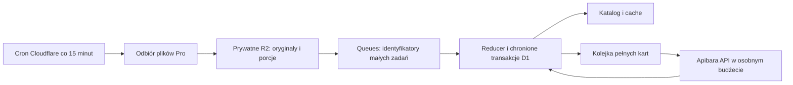

**Nie trzeba codziennie uruchamiać aktualizacji od początku. Docelowo harmonogram na Cloudflare sam pobiera kolejne paczki, zapisuje postęp i wznawia pracę po przerwie, również przy wyłączonym komputerze.** Obecny mały automat API już ma harmonogram serwerowy; pełna synchronizacja plikowa opisana niżej wymaga jeszcze implementacji i wdrożenia. Ten dokument jest projektem z 29.10.2026, nie potwierdzeniem uruchomienia nowych usług.

**Co już istnieje i czego obecny Cron nie załatwia**

`worker.publication.js:148` wywołuje `runAutomaticRefresh`; profil publikacyjny przewiduje Cron co 15 minut. `sync/automatic-refresh.cjs` zachowuje dzierżawę, trwałe próby i budżety, ale ma 8 prób na przebieg, 500/dzień, 12 tys./miesiąc oraz twardą walidację konfiguracji do 30 tys./miesiąc. Osobny licznik zatrzymuje przebieg przy 970 instrukcjach SQL. `inventory-reconcile.cjs` dopuszcza najwyżej dwa szczegóły na przebieg, a jego wywołanie jest związane z ustanowionym globalnym strumieniem. Sam zakup Pro nie zmienił tych ograniczeń.

Gotowe elementy do ponownego użycia: parser i kwarantanna w `scripts/apibara-feed.cjs`, reducer `sync/inventory-change-group.cjs`, kontrolowany zapis `sync/feed-change-import.cjs`, walidacja pełnej obserwacji oraz selektywny rollback. Importer obsługuje do 100 grup LOT w partii i maksymalnie 108 instrukcji zapisu wraz z zabezpieczeniami. Czytnik plików i indeks opierają się obecnie na Node, lokalnym systemie plików i SQLite; potrzebują serwerowego odpowiednika. Samo przeniesienie obecnego polecenia do Cron nie usuwa tej zależności.

**Wolumen i właściwy podział pracy**

| Pomiar | Wniosek projektowy |
|---|---|
| Pierwsze 3,656 mln zdarzeń / 180 435 grup LOT w około 29 h; nocne 1,285 mln / 127 807 w około 12 h | Redukować kolejne zmiany tego samego LOT przed zapisem. Liczba zdarzeń nie jest liczbą potrzebnych odczytów szczegółów. Grupowanie co 30 minut może dać więcej grup niż grupowanie całego 12-godzinnego archiwum; przepustowość trzeba zmierzyć. |
| Nocny napływ odpowiada około 2,57 mln zdarzeń/dobę | Działający endpoint potwierdził maksimum 500, co oznacza około 154 200 wywołań `/changes` w 30 dni, przed szczegółami i kontrolami. Publiczne OpenAPI deklaruje 2000, lecz rzeczywista próba została odrzucona HTTP 422. Nie można oprzeć budżetu Pro ani wyboru transportu na 2000 lub szacunku 38 550 wywołań. Przy potwierdzonym limicie 500 zasadniczym transportem pozostają pliki Pro. |
| Open + zmiana w ostatnich 24 h: 155 237 ofert, limit strony 20 | Około 7 763 wywołań listy: sensowny kandydat do jednorazowego nadrobienia, lecz około 232 890 wywołań przy codziennym powtarzaniu. Bieżące zmiany obsługiwać z plików, a pełne odczyty wybierać z kolejki. |
| Po pierwszym imporcie: 62 752 zadań dotyczy ended, 12 finished, 288 live, 27 777 open, 30 460 brakujących rekordów; dodatkowo 1 988 błędów tożsamości dla brakujących i 72 dla open | Nie jest to 123 tys. pilnych szczegółów. Najpierw known open/live oraz nowe aktywne LOT; brakujące trzeba sklasyfikować na podstawie ostatnich zdarzeń. Zakończone odłożyć do archiwum, konflikty tożsamości do osobnej kwarantanny. |

Starsze sprawdzone `lot.created` zawierały tylko patch; nowsze paczki potrafią zawierać pełną kartę w osobnym `record`. Najpierw wykorzystać poprawny dołączony rekord, a osobne API pozostawić dla jego braku, niekompletności lub konfliktu. Nowy aktywny LOT nadal wymaga sprawdzenia platformy/LOT/VIN i mediów. Niejednoznaczne daty samego patcha nie mogą nadpisywać potwierdzonej daty pełnego rekordu. Aktualizacja ceny/statusu nie zmienia daty potwierdzenia całej karty. Timed ma oddzielny zakres źródłowy; zwykłe Open/All nie dowodzi jego pokrycia.

**Korekta na podstawie zapisanych plików i nowego kontraktu — 29.10.2026**

Publiczne OpenAPI ma obecnie wersję **1.1.1**, deklaruje maksimum `/changes` **2000** i `include_record=false` domyślnie, z opcjami `true`, `all` oraz `created`. Opis wiąże `created` z eksportami Sync Center; `record` jest bieżącym pełnym rekordem, może być null. Lokalna kopia z 27.10 ma wersję 1.1.0, maksimum 500 i nie opisuje `include_record` ani `VehicleChangeEvent.record`. [Aktualny publiczny kontrakt Apibara](https://apibara.tech/openapi/v1.json).

**Wynik rzeczywistej próby operatora, 29.10.2026, 10:48:18 UTC:** `/changes?after=45570246&limit=2000&include_record=created` zwrócił **HTTP 422**, z `message` i `errors.limit`: `The limit field must not be greater than 500.` Nagłówki: Pro, limit 100 000, użyto 9 937, pozostało 90 063. Jedna próba, bez ponowień i zapisów D1; prywatne dowody to receipt oraz `response.json.gz` w `changes-2000-probe-20261029`. Dokumentacja i działający endpoint są rozbieżne: do planowania obowiązuje **500**. Ta odpowiedź nie weryfikuje obsługi API `include_record`, ponieważ żądanie odrzucono na walidacji limitu. Nie podważa ona poniższego dowodu 329 pełnych rekordów w zachowanych plikach.

| Zachowane źródło | Wszystkie zdarzenia | `lot.created` | Obiekt `record` przy created | Faktyczna zawartość mediów |
|---|---:|---:|---:|---|
| 5331 | 47 218 | 173 | 173/173 | 173/173: niepuste `media.items` i `media.thumbs`, 10–22 zdjęcia |
| 5320 | 61 690 | 156 | 156/156 | 156/156: niepuste `media.items` i `media.thumbs`, 7–22 zdjęcia |
| 5202 | 4 221 | 0 | Nie dotyczy | Brak created, więc ta paczka nie rozstrzyga formatu nowych kart |

Liczby rekordów i SHA256 wszystkich trzech plików zgadzają się z zachowanymi manifestami. Wszystkie **329** zbadanych created dotyczą **IAAI**. Każdy `record` ma 27 kluczy, m.in. `platform`, `lot_number`, `vin`, `updated_at`, `auction`, `pricing`, `location`, `seller`, `condition`, `odometer`, `vehicle_specs`, `sale_document`, `media`, `details`, `facility`. Elementy mediów mają klucze `type`, `thumb`, `large`, `url`; potwierdzono adresy HTTP(S), nie tylko puste pola. To pełna struktura rekordu, nie gwarancja niepustej wartości każdego opcjonalnego pola.

Tożsamość platforma/LOT/VIN jest zgodna ze zdarzeniem **329/329**; **328** VIN ma pełny format 17 znaków, jeden jest niestandardowy bez znaku kontrolnego. `auction_at` i `full_date` mają jawną strefę **329/329**. W 5320 cztery `record.updated_at` są nowsze od `event.vehicle_updated_at`, maksymalnie o **184 s**; pozostałe 325 rekordów mają te daty równe. Pełny `record` trzeba zatem obsłużyć jako obserwację według jego własnej wersji/czasu, chronioną przed późniejszym odtwarzaniem starszych patchy, a nie przypisać mu automatycznie czasu `lot.created`.

Dla porównania konkretny historyczny przykład Copart z 4948, sekwencja 40565891, faktycznie nie ma klucza `record`; jego `after` to 19 pól patcha bez mediów. Jest to kontrola pojedynczego starszego zdarzenia, nie całej generacji. Obserwacje potwierdzają działającą zawartość pełnych kart w nowych paczkach IAAI, ale nie ustalają chwili wdrożenia ani pokrycia nowych zdarzeń Copart. Obecny lokalny adapter ogranicza `/changes` do 500 zgodnie z rzeczywistą walidacją endpointu, nie wysyła `include_record`, a znormalizowana postać zdarzenia pomija `record`; surowe zapisane pliki zachowują go. Należy rozszerzyć ścieżkę pełnej obserwacji przed importowaniem nowych kart z dołączonych rekordów. Korekta dokumentu nie zmienia importu nocnego.

**Proponowana architektura bez komputera operatora**

1. **Odbiór.** Prywatny Worker synchronizacji korzysta z sekretu feedu, a nie z sesji przeglądarki. Cron wykrywa generacje, zapisuje strumieniowo oryginalny gzip w R2 i rejestruje SHA256, rozmiar, zakres oraz stan `downloaded`. Powtórzona generacja/hash nie tworzy drugiego importu. Sekret i adres feedu nie trafiają do logów ani publicznej strony.
2. **Walidacja i porcjowanie.** Strumieniowa kontrola gzip/JSONL, kolejności, duplikatów i tożsamości; oryginalne błędne VIN pozostają w archiwum i trwałej kwarantannie. Serwerowy indexer tworzy niezmienne, ograniczone rozmiarem porcje i manifest, grupując zdarzenia LOT z zachowaniem ich kolejności. Nie zapisuje osobnego wiersza D1 dla każdego surowego zdarzenia. Cała generacja musi przejść walidację przed publikacją manifestu `ready`.
3. **Praca ciągła.** Queues przenosi małe identyfikatory porcji i hash, bez wielomegabajtowych danych. Początkowo jeden konsument zapisujący katalog współdzieli istniejącą blokadę; downloader może pracować niezależnie. Konsument wykonuje małe partie do 100 grup i poniżej 970 SQL, po czym zapisuje postęp. Kolejne zadania uruchamia kolejka, zamiast czekać 15 minut po każdej partii.
4. **Pełne karty.** Najpierw walidacja i zapis dołączonego `record` jako pełnej obserwacji. Oddzielny konsument API wybiera aktywne nowe LOT bez poprawnego rekordu, brakujące media i niejednoznaczne zmiany; najpierw aukcje bliskie rozpoczęcia. Zachowuje osobne zakresy Timed. Jednorazowy pełny catch-up może wykorzystać listy `view=full`; nie staje się codziennym pełnym skanem. Konieczny pomiar napływu rzeczywiście nierozwiązanych nowych LOT i wieku kolejki przed obietnicą czasu kompletnego odświeżenia.

Istotna zależność: trzeba potwierdzić maszynowy dostęp do **zaległych generacji** i ich granic. Sam `/latest` może ominąć paczki podczas dłuższej awarii. Do czasu potwierdzenia dostępnego katalogu/odczytu historycznych generacji można wykrywać lukę i naprawiać ją ograniczonym `/changes`; duża luka zatrzymuje przesunięcie globalnego checkpointu i wymaga interwencji. Nie oznaczać najnowszego numeru jako przetworzonego.

Worker ma 128 MB pamięci; Cron częstszy niż raz na godzinę ma 30 s CPU, a godzinny lub rzadszy do 15 min CPU. Cron i konsument kolejki mają 15 min czasu ściennego. Dlatego zwykłe pliki około 4 MB należy przetwarzać strumieniowo, a przygotowanie dużych zaległości około 100 MB wydzielić i zmierzyć osobno, np. zadaniem godzinnym. Nie zakładać, że cały gzip lub jego rozwinięcie zmieści się w pamięci. Zwykły gzip nie zapewnia prostego wznowienia od dowolnego bajtu: po przerwaniu przygotowania odczytać archiwum R2 od początku, ponownie używając identycznych, już zapisanych porcji. [Limity Workers](https://developers.cloudflare.com/workers/platform/limits/).

**Awaria, wznowienie i postęp**

- Rozdzielić checkpointy: odebrany plik, zwalidowany manifest, zatwierdzona partia oraz globalna granica zastosowanych plików. Osobno pozostają pełne obserwacje kart i zadania uzupełnienia.
- Jedna transakcja D1 obejmuje kontrolę dzierżawy/pierwotnego stanu, dozwolone zmiany, kwarantannę/zadania, receipt partii i jej checkpoint. Klucz partii wynika z hasha źródła oraz pozycji. Dla LOT zachować ostatnią zastosowaną sekwencję; odrzucać starsze zmiany i chronić późniejsze pełne obserwacje.
- Konsument zakłada możliwość ponownego doręczenia i dowolnej kolejności. Potwierdza zadanie dopiero po sprawdzeniu trwałego receiptu. Przy niepewnym wyniku zapisu najpierw odczytuje receipt: identyczny oznacza wykonaną partię, konflikt blokuje zapis. Brak receiptu pozwala na kontrolowane wznowienie dopiero po rozstrzygnięciu trwającej próby i dzierżawy; nierozstrzygnięta próba zachowuje `pending` i rezerwację.
- Stan zadania w D1 i outbox zapisać atomowo. Jeśli proces padnie między zapisem a wysłaniem do Queues, następny Cron ponownie wysyła niepotwierdzone zadanie. Kolejka sama nie jest rejestrem ukończenia.
- Błędy przejściowe mają ograniczone próby i opóźnienie; 429 respektuje `Retry-After` oraz wspólny budżet, 401/403 i błędny kontrakt blokują transport. Zablokowane zadanie trafia do osobnej kolejki błędów z przyczyną; archiwum R2 i D1 umożliwiają odtworzenie także po wygaśnięciu wiadomości. Wewnętrzne luki numeracji zdarzeń są dozwolone i wymagają dowodu, nie wymyślonych rekordów.
- Kontrola pokazuje osobno wiek ostatniego pliku, zatwierdzony zakres, czas najstarszego aktywnego zadania pełnej karty, kwarantannę i budżety. Przekroczenie np. dwóch cykli generowania pliku lub rosnący backlog wywołuje alert. Samo `Cron ok` nie oznacza świeżego całego katalogu.

**Koszty i ograniczenia do ustawienia przed wdrożeniem**

Obecne abonamenty według danych zlecenia: Apibara Pro 70 USD/mies. z 100 tys. zapytań i Workers Paid 5 USD/mies. Nie wybrano nowego płatnego pakietu. Poniższe stawki to publiczne ceny Cloudflare sprawdzone 29.10.2026; limity bez dopłat są współdzielone z innym wykorzystaniem konta.

| Składnik | Limit i główny koszt |
|---|---|
| Apibara | Pliki jako transport podstawowy; API na pełne karty, kontrole i ograniczoną naprawę luk. Proponowany budżet całego automatu 80 tys. prób/mies. plus co najmniej 10 tys. rezerwy u dostawcy, dzielony między zadania i uwzględniający inne zużycie. To projekt polityki, nie zmiana obecnych limitów. |
| Workers | Paid obejmuje 10 mln wywołań i 30 mln ms CPU/mies.; dalej 0,30 USD/mln wywołań i 0,02 USD/mln ms CPU. Mierzyć zwłaszcza dekompresję, walidację i grupowanie. [Cennik Workers](https://developers.cloudflare.com/workers/platform/pricing/). |
| D1 | W Paid: 25 mld odczytanych wierszy i 50 mln zapisanych wierszy/mies., 5 GB przechowywania. Nadwyżki: 0,001 USD/mln odczytów, 1 USD/mln zapisów, 0,75 USD/GB-mies. Mierzyć `meta.rows_read/rows_written`, nie samą liczbę SQL. [Cennik D1](https://developers.cloudflare.com/d1/platform/pricing/). |
| R2 Standard | 10 GB-mies., 1 mln operacji A i 10 mln B w darmowej puli; dalej 0,015 USD/GB-mies., 4,50 USD/mln A, 0,36 USD/mln B. Transfer z R2 bez opłat. 4 MB × 48 paczek/dobę × 30 dni to około 5,76 GB oryginałów; porcje, zaległości i kopie zwiększają ten wynik. Retencja np. 30 dni oryginałów, krótsza dla zastosowanych porcji. [Cennik R2](https://developers.cloudflare.com/r2/pricing/). |
| Queues | Paid obejmuje 1 mln operacji/mies.; nadwyżka 0,40 USD/mln. Typowe małe zadanie to trzy operacje, ponowienia dodają odczyty. Rozliczenie co 64 KB, dlatego wysyłać referencje do porcji. Retencja domyślnie 4 dni, maksymalnie 14; trwałe odtworzenie opierać na R2/D1. [Cennik Queues](https://developers.cloudflare.com/queues/platform/pricing/). |

Pierwszy zakończony import zmienił 134 135 grup; przekazany rejestr całego dnia wykazuje około 629 tys. zapisów i 6,2 mln odczytów D1. To użyteczny pomiar kontrolny, ale nie izolowany koszt jednej partii ani prognoza miesiąca. Docelowy koszt wyznacza liczba grup po redukcji w krótkim oknie, zapisów obserwacji/indeksów i potrzebnych pełnych kart. Surowa nocna liczba zdarzeń nie powinna zamieniać się w osobne rekordy D1 lub wiadomości Queues. Limity aplikacji i alerty nie są twardym limitem całej faktury Cloudflare.

**Dokładnie co pozostało do wykonania**

1. Potwierdzić dostęp serwerowy do kolejnych i zaległych plików, identyfikatorów generacji oraz granic; sprawdzić kontrakt wznowienia bez przeglądarki i bez ujawniania prywatnego URL.
2. Dodać prywatny odbiornik R2, strumieniowy walidator/indexer, porcje i manifesty zastępujące lokalne pliki/SQLite. Zachować `record` w normalizacji, walidować i importować go przez ścieżkę pełnej obserwacji; uwzględnić jego własne `updated_at`. Zachować semantykę reducerów oraz kwarantannę całej grupy przy konflikcie tożsamości. Utrzymać limit API 500 do rozstrzygnięcia rozbieżności dokumentacji; obsługa `include_record` w API wymaga osobnej autoryzowanej weryfikacji z dopuszczalnym limitem.
3. Dodać addytywne tabele generacji, porcji, outboxu i receiptu/postępu, konsumenta Queues oraz odzyskanie dzierżawy. Nie uruchamiać konkurencyjnego zapisu z aktualnym operatorem importu.
4. Oddzielić konsumenta pełnych kart od warunku uruchomionego globalnego API streamu; sklasyfikować backlog aktywne/archiwum/tożsamość. Zmienić i przetestować obecne ograniczenia 12 tys./30 tys. oraz dwa szczegóły na przebieg zgodnie z zatwierdzonym budżetem Pro; bez zerowania liczników.
5. Na kopii przeprowadzić testy duplikatu, przestawionej porcji, awarii po commicie przed potwierdzeniem, przerwania gzip, luki generacji, 429, kwarantanny i nowszej pełnej obserwacji. Zmierzyć CPU/pamięć/SQL/wiersze oraz przepustowość plików 4 MB i 100 MB; konsument musi stale wyprzedzać napływ z zapasem.
6. Po zakończonym i zweryfikowanym catch-up ustanowić konkretną globalną granicę, wdrożyć ograniczony rozruch z monitoringiem i kontrolą kosztów, następnie wykonać próbę odzyskania po przerwie. Dopiero taki test potwierdzi samodzielną pracę bez codziennej obsługi.

**Uzupełnienie koordynatora, 29.10.2026 około10:30 UTC.** Panel nadal pokazuje Pro i aktywny feed co30min. Zachowano5331 (47218 zdarzeń,45570247–45617472), bez dołączania do trwającego night-v2. Dokumentacja potwierdza prywatny stały adres najnowszego pliku, historię plików48h oraz brak zużycia zwykłej puli przy pobieraniu. To wystarcza do podstawowego automatycznego odbioru w Pro; maszynowy odczyt historii generacji nadal nie został potwierdzony. Webhook nie jest wymagany do zwykłego pobierania harmonogramem. [Zakres Sync Center](https://apibara.tech/en/vehicle-auction-incremental-sync-api).

Przewodnik dostawcy potwierdza14dni dziennika zmian, dozwolone luki numeracji i trwałe zadanie uzupełnienia przed przesunięciem checkpointu. Pełne dane nie występują w każdym zdarzeniu; starszy replay nie może nadpisać nowszej obserwacji. To wymagania następnej implementacji, nie dowód wdrożenia. [Wznowienie i checkpointy](https://apibara.tech/en/guides/copart-iaai-database-sync).

Podstawa lokalna: [runbook automatu](C:/Users/nowic/Desktop/stona_auta-www/docs/AUTOMATIC_REFRESH_RUNBOOK.md), [kontrakt plików](C:/Users/nowic/Desktop/stona_auta-www/docs/APIBARA_INCREMENTAL_CONTRACT_2026-10-28.md), [aktualny moduł automatu](C:/Users/nowic/Desktop/stona_auta-www/sync/automatic-refresh.cjs), [importer grup](C:/Users/nowic/Desktop/stona_auta-www/sync/feed-change-import.cjs) oraz [pomiar dwóch platform](C:/Users/nowic/Documents/Codex/REXBID_LIVE_UPDATES_20261029/active-refresh-sizing-20261029.json). Stan bieżących importów i końcowe liczniki podane przez operatora nadrzędnego mają pierwszeństwo przed starszymi opisami w runbooku. Autor projektu nie wykonywał wywołań konta Apibara, zmian D1, wdrożenia ani aktywacji R2/Queues; osobny przebieg koordynatora ma własne raporty operacyjne.
